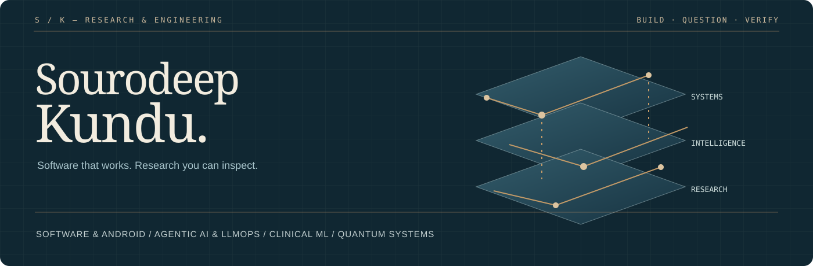

<!-- Generated from content/profile.json by scripts/render-profile.mjs. -->
<picture></picture>

<a href="https://github.com/sourodeepkundu2025-hub/sourodeepkundu2025-hub/blob/main/assets/Sourodeep_Kundu_CV_2026_Main.pdf"><strong>CV (PDF)</strong></a> · <a href="https://www.linkedin.com/in/sourodeep-kundu-460b69270/">LinkedIn</a> · <a href="https://scholar.google.com/citations?user=n7Fe3fsAAAAJ&hl=en">Google Scholar</a> · <a href="https://www.researchgate.net/profile/Sourodeep-Kundu">ResearchGate</a> · <a href="mailto:sourodeepkundu9@gmail.com">Email</a> · <a href="CAREER_RECORD.md">Research & career overview</a>

### Hello, I'm Sourodeep.

I build software and study learning systems where the hard questions are about evidence, resources and reliability. My work connects Android and healthcare engineering, retrieval and agent orchestration, and hybrid quantum research.

**SDE Apprentice — AI, Healthcare & Android, Philips R&D / AM&D · May 2026–present** 
M.Tech. Computer Science Engineering (Core), VIT Vellore · 2025–2027 · ongoing 
B.Tech. Computer Science Engineering, KIIT · 2021–2025

I like the point where an ambitious idea meets an engineering constraint: a circuit with limited connectivity, a model with a call budget, a retrieval system that needs to justify its answer, or a device workflow that must recover clearly.

### Explore the work

| Project | Engineering question | What you can inspect |
| --- | --- | --- |
| **[Circuit Route Lab](https://github.com/sourodeepkundu2025-hub/circuit-route-lab)** New educational reference implementation | How does connectivity change a circuit? | Interactive mesh routing, explicit logical-to-physical mappings and exact ideal three-qubit teleportation. [Live demo](https://sourodeepkundu2025-hub.github.io/circuit-route-lab/) · [Run instructions](https://github.com/sourodeepkundu2025-hub/circuit-route-lab#run) · [Tests](https://github.com/sourodeepkundu2025-hub/circuit-route-lab/tree/main/test) |
| **[Evidence Gate Lab](https://github.com/sourodeepkundu2025-hub/evidence-gate-lab)** New synthetic-data reference implementation | What evidence supports an answer? | An offline retrieval instrument with evidence budgets, verified quotations, permission gates and abstention. [Live demo](https://sourodeepkundu2025-hub.github.io/evidence-gate-lab/) · [Run instructions](https://github.com/sourodeepkundu2025-hub/evidence-gate-lab#run) · [Tests](https://github.com/sourodeepkundu2025-hub/evidence-gate-lab/tree/main/test) |
| **[Parallel Circuit Routing](https://github.com/sourodeepkundu2025-hub/sourodeepkundu2025-hub/tree/main/practice/parallel-route)** Personal practice · in progress | How can independent routing candidates be evaluated in parallel? | C++17/OpenMP practice prototype with BFS, logical-to-physical mappings, look-ahead scoring and a CSV routing trace. Source compiles; runtime validation and benchmarking are pending. [Source & build guide](https://github.com/sourodeepkundu2025-hub/sourodeepkundu2025-hub/tree/main/practice/parallel-route) · [OpenMP learning demo](https://www.youtube.com/watch?v=3gwV6iBF6E0) |

These projects include educational reference implementations and ongoing personal practice. The original research and larger platforms have their own release requirements; see the [project roadmap](ROADMAP.md).

### Where my work connects

| Area | Practice | Tools |
| --- | --- | --- |
| **Software & dependable systems** | Android, Bluetooth, Java/native interfaces, lifecycle and recovery design; full-stack APIs and CI/CD. | Python · Java · TypeScript · SQL · Android · FastAPI · React |
| **Agentic AI & LLMOps** | Hybrid retrieval, citation grounding, model routing, streaming, MCP integrations and checkpointed workflows. | LangGraph · CrewAI · MCP · Ollama · RRF / FTS5 |
| **ML & clinical research** | Multimodal and federated models, patient-disjoint evaluation, ablations, calibration and uncertainty. | PyTorch · TensorFlow · scikit-learn · OpenCV |
| **Quantum information & systems** | Circuit mapping, QKD, tensor networks, QUBO/QAOA and resource-aware quantum/classical studies. | Qiskit · PennyLane · SeQUeNCe · D-Wave Ocean |

### Research threads

- **QVoC** — Selective hybrid inference with patient-disjoint evaluation and classical/neural early-exit controls; IBM circuit studies have separate scope. *Research manuscript.*
- **HQFL-QNet** — Compressed-feature federated learning and QUBO selection with heterogeneous-client controls. *Research manuscript.*
- **DEQUINT** — Entanglement, teleportation and multicore wireless interconnect simulation. *Research manuscript / simulation.*
- **QML-AURA / AURA-Q** — Resource allocation and feasible processor selection using QUBO/QAOA, fairness constraints and classical fallback. *Simulation research.*

My research experience includes circuit synthesis at IIEST Shibpur, multicore quantum-interconnect simulation at IIT Guwahati, tensor networks at NIT Silchar, and generative QML at IISER Bhopal.

**Currently exploring:** Investigating distillation and quantization of open-source LLMs with Ollama/vLLM.

### Papers and public records

Selected publications include [QLSTM4FM](https://doi.org/10.1109/IC-SIT63503.2024.10862667), [QEA-FAD](https://doi.org/10.1109/NETCRYPT65877.2025.11102801), and [nearest-neighbor circuit transformation](https://doi.org/10.1109/VDAT63601.2024.10705747). See the [publication register](CAREER_RECORD.md#publications) for the broader record.

Model studies, physical circuit experiments and simulation results have different scopes. Each released research repository will carry its own data, methods, baselines and limitations.

### More repositories

- [Digital Art Commission](https://github.com/sourodeepkundu2025-hub/digital-art-commission) — Full-stack case-study application for commission records and business-rule validation.
- [AI Resume Screening System](https://github.com/sourodeepkundu2025-hub/AI-Resume-Screening-System) — A screening prototype with a web interface, Python integration and documented output formats.
- [Ticket Reservation System](https://github.com/sourodeepkundu2025-hub/ticket-reservation-system) — A Java application repository; the original project remains available for inspection.

### Let's build something worth inspecting.

I'm interested in research collaboration and engineering work across software systems, AI/LLMs, clinical ML and quantum information. [Contact me](mailto:sourodeepkundu9@gmail.com) or explore the repositories above.

Profile record updated 2026-10-20. Project documentation records provenance, completed checks and remaining work.
