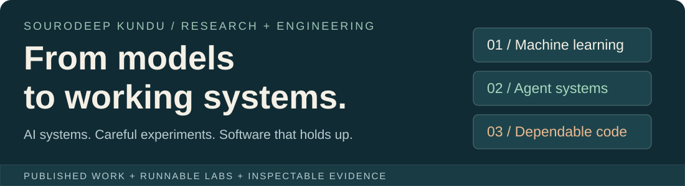
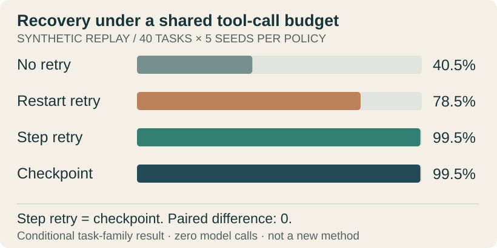
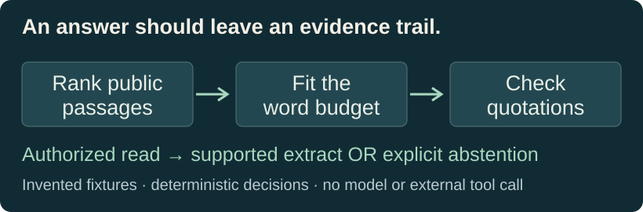

<!-- Generated from content/profile.json, checked metadata and scripts/render-profile.mjs. -->
# Hey, I'm Sourodeep 👋

**Agentic AI · Machine learning · Dependable software**

I like the point where a model becomes a system: when its data changes, its tools fail, its memory fills up, and someone still needs an answer they can inspect.

My background connects machine-learning research, constrained computation and healthcare software engineering. I am pursuing an **M.Tech. in CSE at VIT Vellore**, alongside my work as an **SDE Apprentice in AI, Healthcare & Android at Philips**. My published work spans learning models and circuit transformation; my current research direction is **reliable agents, trustworthy evaluation and efficient LLM systems**.

I enjoy moving between the mathematics and the implementation: understanding an objective, building the mechanism, finding a stronger baseline, and tracing what broke. This page connects that work to code you can inspect, experiments with stated limits, and the research record behind it.

[LinkedIn](https://www.linkedin.com/in/sourodeep-kundu-460b69270/) · [Google Scholar](https://scholar.google.com/citations?user=n7Fe3fsAAAAJ&hl=en) · [ResearchGate](https://www.researchgate.net/profile/Sourodeep-Kundu) · [Email](mailto:sourodeepkundu9@gmail.com)

[Public labs](#public-engineering-labs) · [Published research](#selected-published-research) · [Research in progress](#research-in-progress) · [Experience](#selected-experience) · [Capabilities](#capabilities-with-an-evidence-trail)

## Public engineering labs

These are owned, runnable reference implementations. They demonstrate specific mechanisms; they do not stand in for private professional code or reproduce earlier research papers by association.

### 01 / Agent Reliability Lab

**Question:** what should a stateful workflow do when a tool fails—or commits an action but loses the acknowledgement?

The lab implements an exactly-once synthetic ledger, strict action/observation contracts, typed fault traces, idempotent replay, call budgets and paired task-level analysis. Failed requests are charged. The evaluator's state and fault schedule stay outside the controller interface.

**Evidence:** the content-disjoint amendment has 40 tasks × five seeds × four controllers. Strong step retry and checkpoint recovery both reach **99.5% success**, with **7.18 mean tool calls** and zero paired advantage. The weaker restart comparison and the subsequent correction are both retained. This is a useful baseline/control finding, **not a novel checkpoint method or an LLM result**.

[Source & run instructions](https://github.com/sourodeepkundu2025-hub/agent-reliability-lab) · [Frozen results](https://github.com/sourodeepkundu2025-hub/agent-reliability-lab/tree/d919938e44ffdde2f26ddeb13b0c40da297dff3d/artifacts/amendment-content-disjoint-audit) · [CI](https://github.com/sourodeepkundu2025-hub/agent-reliability-lab/actions)

### 02 / Evidence Gate Lab

**Question:** can a retrieval system show what supports its output, respect a resource limit, and explicitly say when it cannot answer?

The shared JavaScript core powers a browser instrument, CLI and regression tests. It validates source identities, excludes private-labelled fixtures, ranks by lexical coverage, selects complete passages and checks normalized quotations. Reduce the word budget, ask an unsupported question or request a write: the decision trace explains the result.

**Boundary:** invented documents and deterministic extraction, not semantic RAG, model reasoning or a production authorization boundary. Quote provenance does not establish truth or entailment.

[Try the interactive demo](https://sourodeepkundu2025-hub.github.io/evidence-gate-lab/) · [Code & tests](https://github.com/sourodeepkundu2025-hub/evidence-gate-lab) · [Actual browser preview](assets/evidence-demo.png)

### 03 / Circuit Route Lab

**Question:** how does limited connectivity change a circuit—and what does ideal quantum teleportation actually require?

Play a routing sequence, step through SWAP events and inspect the updated logical-to-physical mapping. The separate three-qubit statevector panel exposes measurement branches and conditional corrections. It connects earlier architecture research to an inspectable educational implementation.

**Boundary:** greedy routing is not globally optimal; ideal simulated fidelity is not a hardware result. The routing and teleportation panels do not claim to implement a physical quantum interconnect.

[Try the interactive demo](https://sourodeepkundu2025-hub.github.io/circuit-route-lab/) · [Code, tests & assumptions](https://github.com/sourodeepkundu2025-hub/circuit-route-lab)

### More application work

| Repository | What you can inspect |
| --- | --- |
| [Digital Art Commission](https://github.com/sourodeepkundu2025-hub/digital-art-commission) | Full-stack case-study application for commission records and business-rule validation. |
| [AI Resume Screening System](https://github.com/sourodeepkundu2025-hub/AI-Resume-Screening-System) | A screening prototype with a web interface, Python integration and documented output formats. |
| [Ticket Reservation System](https://github.com/sourodeepkundu2025-hub/ticket-reservation-system) | A Java application repository; the original project remains available for inspection. |

These existing application repositories remain separate from the new reference labs. Their source is linked without importing research results, employer implementations or unmeasured performance claims.

## Selected published research

My publication record includes learning-model studies as well as earlier work on quantum-circuit connectivity and synthesis. Selected DOI-linked work:

- **[QEA-FAD: Quantum Enhanced Autoencoders for Anomaly Detection in Finance and Healthcare](https://doi.org/10.1109/NETCRYPT65877.2025.11102801)** 
  IEEE · NETCRYPT 2025. Registry publication year: 2025. First-listed author.

- **[QEFMLA-FIDO: Quantum Evolution Formulation for ML Advancement: Fidelity-Improved Data Optimization in Quantum-Classical Systems](https://doi.org/10.1109/AESPC63931.2024.10871986)** 
  IEEE · AESPC 2024. Registry publication year: 2024. First-listed author.

- **[QLSTM4FM: Quantum Assisted Long Short-Term Memory Framework for Financial Market Trend Forecasting](https://doi.org/10.1109/IC-SIT63503.2024.10862667)** 
  IEEE · IC-SIT 2024. Registry publication year: 2024. First-listed author.

- **[Enhanced Quantum Circuit Layout Optimization: A 2D Nearest Neighbour Approach Leveraging K-Means Clustering and A* Swapping](https://doi.org/10.1007/978-981-95-0497-8_39)** 
  Springer · COMSYS 2024 proceedings · 2026. Registry publication year: 2026. Co-author.

[Complete eight-work bibliography and co-author lists](PUBLICATIONS.md) · [Google Scholar](https://scholar.google.com/citations?user=n7Fe3fsAAAAJ&hl=en)

Bibliographic titles and author identities were checked against Crossref. Proceedings/event years and publication years are kept distinct; this metadata check is not a reproduction or performance audit.

## Research in progress

Alongside the published work, these research threads are at manuscript or simulation stage—not additional published papers or public clinical systems.

| Thread | Question / method focus | Current evidence class |
| --- | --- | --- |
| **QVoC** | Selective hybrid inference with patient-disjoint evaluation and classical/neural early-exit controls; IBM circuit studies have separate scope. | Research manuscript |
| **HQFL-QNet** | Compressed-feature federated learning and QUBO selection with heterogeneous-client controls. | Research manuscript |
| **DEQUINT** | Entanglement, teleportation and multicore wireless interconnect simulation. | Research manuscript / simulation |
| **QML-AURA / AURA-Q** | Resource allocation and feasible processor selection using QUBO/QAOA, fairness constraints and classical fallback. | Simulation research |

The public labs above are independent reference work, not the original implementations of these manuscripts. Manuscript and simulation status is retained so existing research is not mistaken for additional published results.

## Selected experience

| Period | Context | Work focus |
| --- | --- | --- |
| May 2026–present | **Philips R&D / AM&D** — SDE Apprentice — AI, Healthcare & Android | Android/Bluetooth/service recovery and AI/document/retrieval tooling; public summaries describe transferable engineering, not employer source or product ownership. |
| Sep 2025–May 2026 | **C-DAC Chennai** — Research internship | Quantum/cloud/edge scheduling and resource-selection research; simulation and feasibility constraints, not live multi-QPU deployment. |
| Feb–Jul 2025 | **Recruit CRM** — CS Associate | API workflows, onboarding automation, chatbots and customer-support engineering. |
| May–Jul 2024 | **IIT Guwahati · MARS Lab** — Summer Research Intern | SeQUeNCe-based multicore quantum-interconnect modelling, qubit management, entanglement and teleportation simulation. |
| May–Jun 2023 | **IIEST Shibpur** — Research internship | C++/Python circuit synthesis, qubit ordering, SWAP reduction and look-ahead mapping in simulation. |

Additional research contexts and education

| Period | Context | Work focus |
| --- | --- | --- |
| Nov 2024–Feb 2025 | **IIT Bombay · LOQM** — Research internship account | Programmable photonics and waveguide research; optics-informed neural learning was a proposed direction, not a built photonic processor. |
| Jun–Jul 2024 | **NIT Silchar · S.N. Bose programme** — Summer research intern | Tensor-network structures and hybrid QML study using Qiskit/PennyLane; the programme is not an appointment at S.N. Bose National Centre. |
| 2024 | **IISER Bhopal** — QML research internship | Generative quantum models, Qiskit and error-correction study; year-only date retained from the current career record. |
| Dec 2023–Jan 2024 | **IIT Patna** — SERB-supported project associate account | Quantum-neuromorphic computing and QKD/secure-communication protocol study. |

- M.Tech. Computer Science Engineering (Core), VIT Vellore · 2025–2027 · ongoing
- B.Tech. Computer Science Engineering, KIIT · 2021–2025

This is selected career context, not a claim that the public labs are institutional projects or endorsements. Offers and selections that did not become attended roles are not represented as completed experience.

[Extended research and career overview](CAREER_RECORD.md)

## Capabilities with an evidence trail

| Area | Mechanisms I work with | Inspectable route / scope |
| --- | --- | --- |
| **ML and model evaluation** | Representation learning, recurrent models, anomaly detection; split design, controls, ablations and uncertainty. | [Published ML research and the manuscript summaries](PUBLICATIONS.md). Published work + manuscripts; no new model benchmark claimed. |
| **Agent runtimes and recovery** | Strict actions, idempotency, typed state transitions, fault injection and budgeted recovery. | [Agent Reliability Lab: source, tests, configs and raw traces](https://github.com/sourodeepkundu2025-hub/agent-reliability-lab). Implemented synthetic reference; not an LLM result. |
| **Retrieval and evidence** | Lexical ranking, whole-passage budgets, quotation provenance and abstention. | [Evidence Gate Lab: browser demo, CLI and shared core](https://github.com/sourodeepkundu2025-hub/evidence-gate-lab). Implemented deterministic reference; not semantic RAG or an LLM. |
| **Dependable software** | Android/service lifecycle, Bluetooth integration, API workflows and observable recovery. | [Professional context and owned public application repositories](CAREER_RECORD.md). Career summary; employer implementations remain private. |
| **Architecture and constrained computation** | Connectivity, mapping, resource accounting and explicit logical/physical state. | [Circuit Route Lab and published circuit-transformation work](https://github.com/sourodeepkundu2025-hub/circuit-route-lab). Educational baseline + publications; no optimality/hardware claim. |

<picture><source media="(prefers-color-scheme: dark)" srcset="https://skillicons.dev/icons?i=python,pytorch,tensorflow,cpp,java,android,docker,git,linux&amp;theme=dark&amp;perline=9"></picture>

**Languages / systems:** Python, C++, Java, TypeScript, SQL, Android, APIs and Git-based CI/CD. 
**Models / research:** PyTorch, TensorFlow, scikit-learn, OpenCV, Qiskit, PennyLane and SeQUeNCe. Framework familiarity is not a substitute for a measured result.

## Compare notes or build together

I'm interested in research conversations and collaborations around **reliable AI systems, evaluation and efficient learning/inference**. A careful failure analysis, a stronger baseline or a well-designed experiment is a good place to start.

[Email](mailto:sourodeepkundu9@gmail.com) · [LinkedIn](https://www.linkedin.com/in/sourodeep-kundu-460b69270/) · [Scholar](https://scholar.google.com/citations?user=n7Fe3fsAAAAJ&hl=en)

Source-linked work, not a badge wall. [Visual provenance](VISUAL_SOURCES.md) · [Maintain from any machine](OPERATIONS.md) · Updated 2026-10-20.
